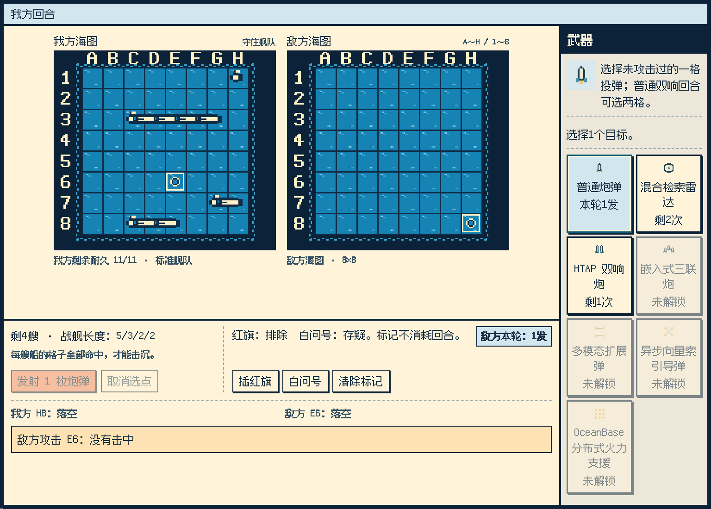
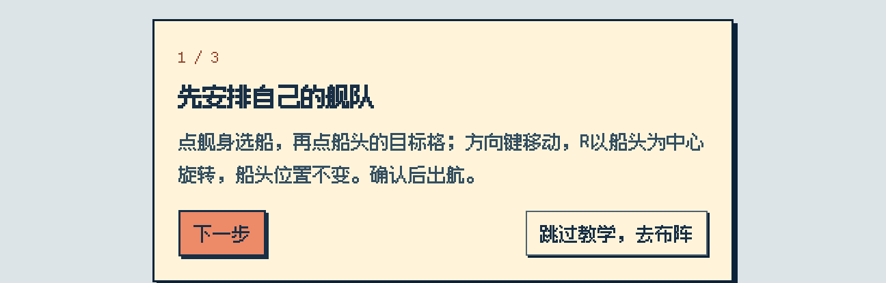
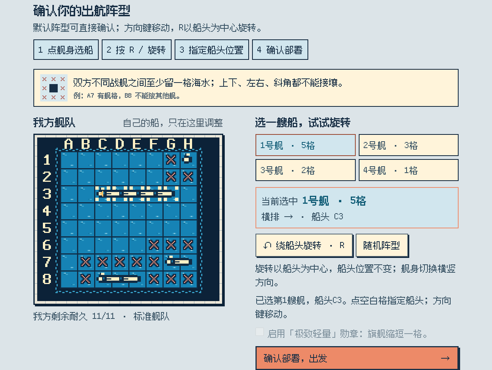
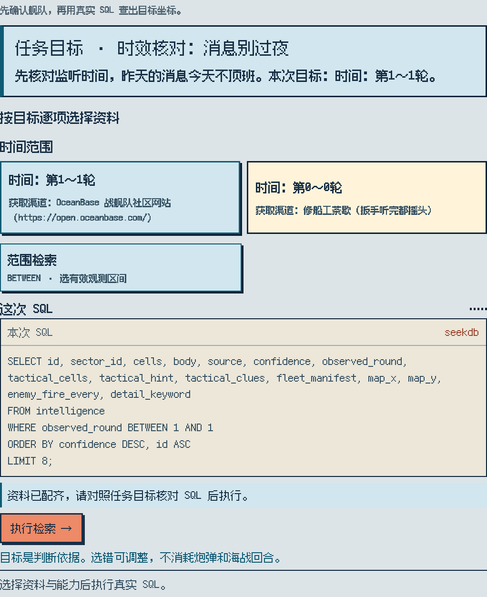
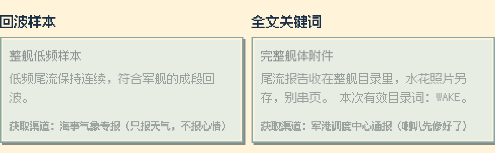
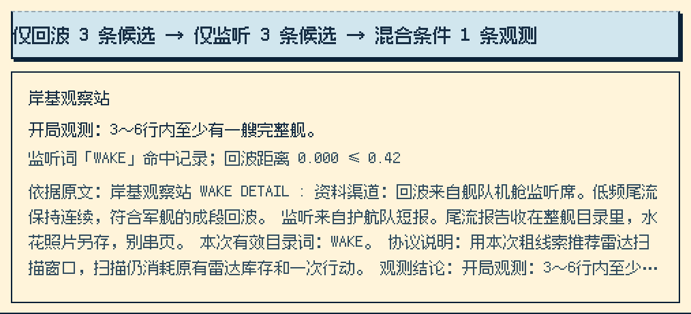
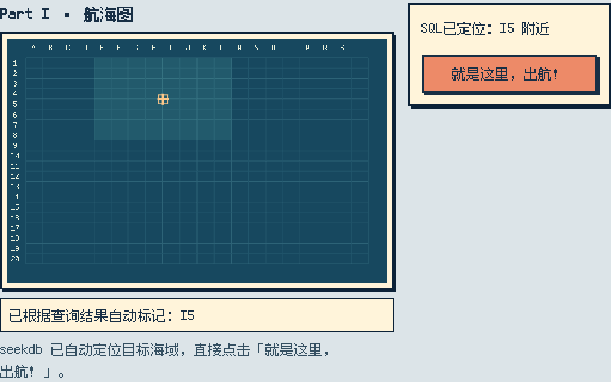
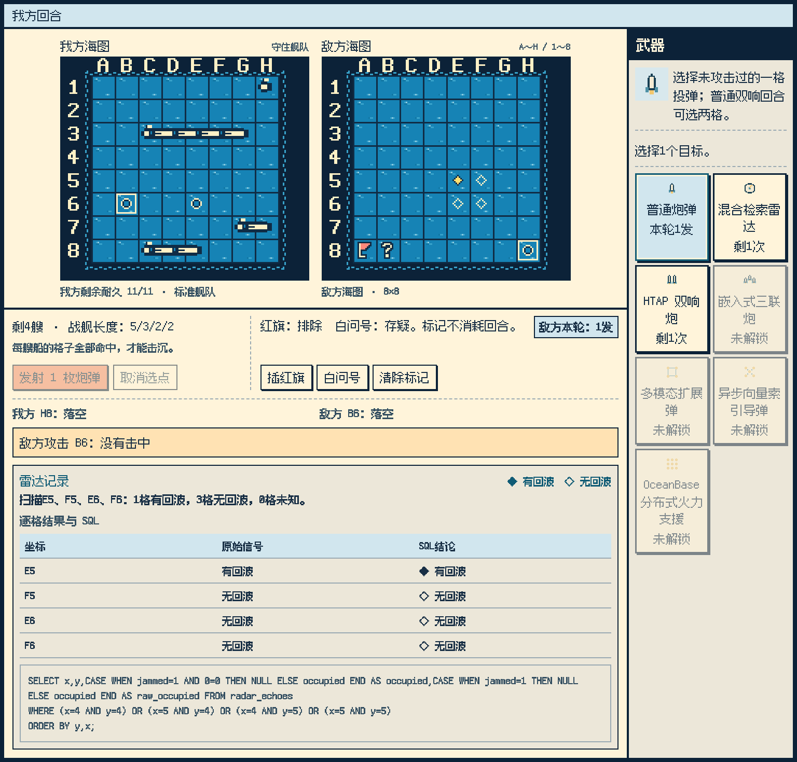
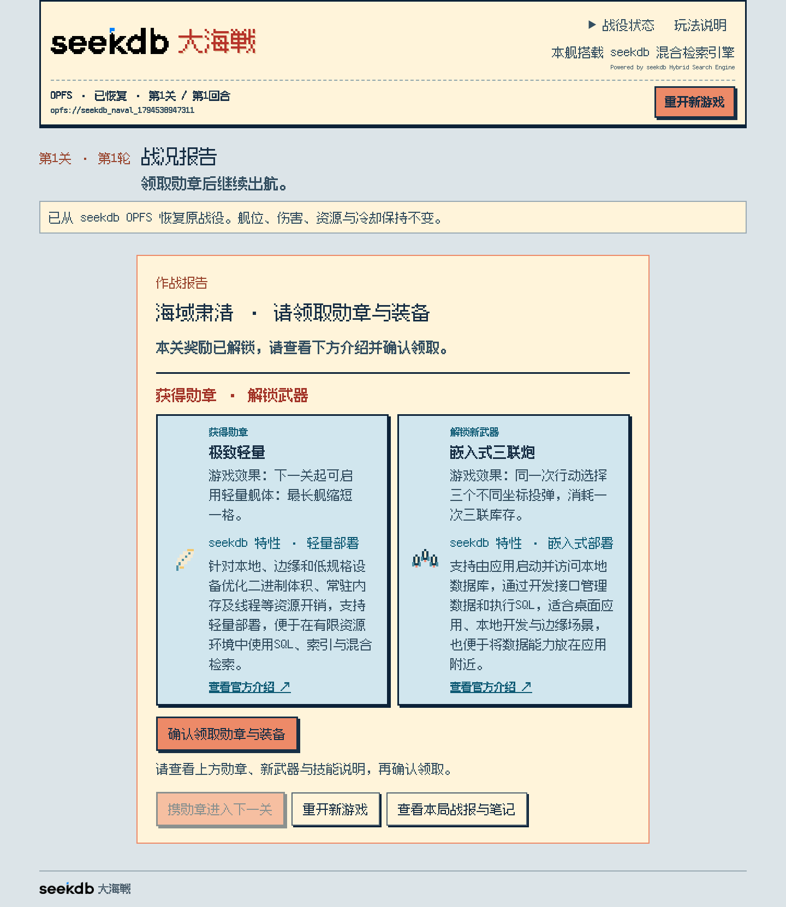
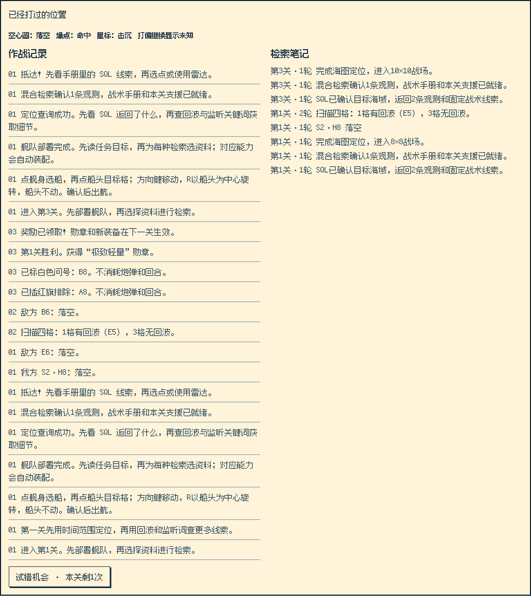

# seekdb 大海戦

**seekdb 大海戦是一款基于 seekdb WebAssembly（Wasm）构建的中文像素海战游戏，SQL 在浏览器内由真实 seekdb 引擎执行。**

先安排自己的舰队，再用混合检索找到敌方海域、带回战术线索，最后在双棋盘上指挥回合制海战。每一关都有“情报检索＋海域交战”两部分，六关棋盘由 8×8 扩展到 10×10、12×12。



## 下载后直接试玩

| 电脑系统 | 离线 ZIP | 解压后运行 |
|---|---|---|
| macOS：Apple Silicon / Intel | **[下载 Mac 版](https://github.com/liboyang0730/seekdb-wasm-battleship/releases/latest/download/seekdb-wasm-battleship-macos.zip)** | 双击 `点此开玩.command` |
| Windows x64 | **[下载 Windows 版](https://github.com/liboyang0730/seekdb-wasm-battleship/releases/latest/download/seekdb-wasm-battleship-windows.zip)** | 双击 `点此开玩.exe` |

[全部版本与更新说明](https://github.com/liboyang0730/seekdb-wasm-battleship/releases)

1. 完整解压 ZIP，让包内文件保留在同一文件夹。
2. 双击对应的“点此开玩”启动文件，系统默认浏览器会打开游戏。
3. 如果未自动打开，将启动窗口里的 `http://127.0.0.1:端口/` 网址复制到浏览器。
4. 试玩时保留启动窗口，结束后关闭即可。

**试玩不需要联网，也不需要安装 Python、Go、Node.js 或 seekdb。** 包内已包含游戏、字体、图片、原生本机启动器和两套官方 seekdb Wasm。Mac 包只有 HTML、启动脚本和启动程序三个文件；Windows 包只有 HTML 与启动程序两个文件。

浏览器内使用内存数据库：**刷新或关闭页面会重置本轮战役。** 游戏资源无需外网；主动点击“查看官方介绍”等链接时才会访问相应网站。当前版本不制作音效和背景配乐。

## 从这里开始：舰长速成

每一关按下面的顺序操作：

**确认舰队 → 读任务目标 → 选择资料并查询 → 选择回波与监听资料并执行混合检索 → 阅读 SQL 结果 → 确认自动定位 → 选武器、选格、开炮 → 领取奖励。**



首次进入可以跟随教学；教学进行中也能随时点击“跳过教学，去布阵”。跳过教学后仍需要确认本关舰队部署。

下方是按游玩顺序编排的图文说明。更完整的键位、逐关资源、图例、例题与常见问题见 **[《seekdb 舰长作战手册》](docs/manual.md)**。截图均来自本项目的实际游戏界面；海域、阵型、口令和线索随战役种子变化，请以自己那一局的任务为准。点击图片可放大查看。

## 1. 先安排自己的战舰



- 点击任意一段舰身，或右侧舰船按钮，选中一艘战舰。
- 点击棋盘空白格，将选中战舰的**船头**放到这一格；也可以使用键盘方向键逐格移动。
- 按 **R** 或点击“绕船头旋转”：**以船头为旋转中心，船头不动，舰身切换横排与竖排。**
- 船体不能出界，不能与其他战舰重叠，也不能与其他战舰接壤。相邻的上、下、左、右和四个斜角都算接壤。
- 其他战舰周围的禁放格会以特殊线条提示。若旋转失败，可先把船头移到更空旷的位置，再旋转。
- 点击“随机阵型”会重新排列我方舰队；也可以直接使用默认合法阵型。
- 确认无误后，点击“确认部署，出发”。

**敌方战舰同样遵守不接壤规则，斜角也不会相邻。** 例如 A7 有一段战舰，其他战舰就不能占据 B8。击沉一艘舰后，可以利用这一规则排除它周围的格子。

我方第一关保留 1 格潜艇。前四关敌方最短战舰为 2 格；第五、六关才出现敌方 1 格潜艇，并相应增加雷达资源。

## 2. 对照任务目标，选择定位资料



屏幕上的“任务目标”是判断资料的依据。按目标逐项选择相符资料，例如当前监听时间、目标呼号、军用回波特征或任务条件。每种定位检索资料都有一个干扰项；选择资料后，对应检索能力会自动装配，下面的 SQL 会实时变化。

- **范围检索**：使用时间、数值等区间，排除过期或不合范围的记录。
- **全文检索**：通过 `MATCH ... AGAINST` 匹配监听口令或呼号。
- **向量检索**：用向量距离寻找与指定战术特征接近的记录。
- **条件过滤**：按照本关任务条件进一步筛选。

选齐后点击“执行检索”。游戏会把 SQL 送进浏览器 Worker 中的真实 seekdb，展示实际返回的记录和结果解释。选错资料可以调整后重查，**不消耗炮弹，也不消耗海战回合**。

资料来源里有正式渠道，也有海鸥纸条、坊间传言等搞笑干扰。优先对照任务内容；不要仅凭卡片位置记答案。定位查询采用的检索能力会随关卡增加。

## 3. 再做一次混合侦察，带上线索出航





定位成功后进入“混合侦察”。这里的回波资料与监听资料各只有一份有效选项：**分别点击两张卡，再点击“执行混合检索”。**

这一步将全文关键词、向量距离和当前任务条件组合起来，结果会加入作战手册。界面会展示仅按回波、仅按监听以及混合条件各自得到的候选数量，让你看到组合查询为什么更准确。

线索可能包括：

- 某两组行或列分别包含多少个敌军舰格。
- 某个宽范围内至少存在一艘完整战舰。
- 某个 2×2 或 3×3 区域没有敌舰，可以排除。
- 特定长舰的朝向、跨越的分界，或后期潜艇的大致活动带。

**线索描述的是范围、数量或存在性，不会直接给出敌方每艘战舰的全部坐标。** “某带内至少有一艘完整舰”也不表示所有战舰都在这一带。开局统计保持固定，炮击之后不会改写成剩余舰格数量。

## 4. 确认自动定位，进入核心海战



SQL 查询成功后，游戏会根据结果自动标记大海图的位置。查看参考坐标，直接点击 **“就是这里，出航！”** 即可。无需手动在大海图上猜位置。

之后进入双棋盘：左侧为我方舰队，右侧为敌方海图。列坐标使用字母，行坐标使用数字，例如 **C5 = C 列、第 5 行**。8×8 使用 A～H / 1～8，10×10 使用 A～J / 1～10，12×12 使用 A～L / 1～12。

## 5. 选武器、选落点，再开炮


1. 在右侧武器栏选择本轮武器。
2. 在敌方海图上选择目标；双发、三联武器需要分别选择足够数量的格子，多点模板武器则选择左上角锚点。
3. 确认落点或覆盖预览，点击发射按钮。
4. 我方发射动画出现在敌方棋盘；敌方还击动画出现在我方棋盘。等待双方演出结束后，再进行下一轮操作。

普通炮不能向本关已经投过炮弹的格子重复投弹。多点武器允许覆盖已经打过的格子，但旧格不会重复造成伤害。雷达是侦察行动，不会代替炮击。

| 海图标记 | 含义 |
|---|---|
| 空心圆 ○ | 炮弹落空，这一格已经攻击过 |
| 爆点 | 炮弹命中敌方战舰的一段 |
| 击沉标记 ★ | 对应战舰全部舰格被击穿，战舰被击沉 |
| 黄色实心菱形 ◆ | 雷达发现回波；不是已经命中 |
| 空心菱形 ◇ | 雷达未发现回波 |
| 红色小旗 | 你的排除笔记，不是系统自动判定的命中 |
| 白色问号 | 你的存疑笔记 |

战舰的每一个格子都被命中，才算击沉整艘战舰。命中一格后，可以结合战舰长度、方向和不接壤规则向相邻格追击。若发生“打偏”，格子继续保持未知。

## 6. 雷达与海图笔记



**混合检索雷达扫描完整的 2×2 四格，消耗一次雷达库存和一次行动。** 扫描结果会逐格留在海图上：◆ 有回波、◇ 无回波。有回波表示仍需炮击确认或攻击；扫描本身不伤害战舰。

选中一个格子后，可以点击“插红旗”“白问号”或“清除标记”。标记不消耗炮弹，也不消耗回合；你也可以用鼠标右键循环切换标记。

“根据 SQL 检索线索标记空海”只会使用已经通过查询获得、能够证明为空海的线索。普通的“某半盘有舰格”或“某范围至少有一艘完整舰”不能用来把其余海域全部排除。

战术手册中的 SQL 线索会持续展示；点击“展开战报与笔记”可以查看已投弹位置、双方作战记录与检索笔记，并可再次收起。

## 7. 武器图鉴

特殊武器有本关库存，耗尽后显示“已用”；尚未取得的武器显示“未解锁”。特殊武器占用一次完整行动，不叠加本轮普通双炮。

| 武器 | 操作与效果 | 首次可用 |
|---|---|---|
| 普通炮弹 | 选择 1 格；获得 MySQL 兼容勋章后，指定普通双响回合可选 2 格 | 第1关 |
| 混合检索雷达 | 选择 2×2 区域的左上角，逐格记录有无回波 | 第1关 |
| HTAP 双响炮 | 手动选择 2 个不同落点，一次发射 | 第1关 |
| 嵌入式三联炮 | 手动选择 3 个不同落点，一次发射 | 第2关 |
| 多模态扩展弹 | 4×4 范围的四角四点；选择左上角锚点 | 第5关 |
| 异步向量索引导弹 | 3×3 范围的四角＋中心，形成 X 形五点 | 第6关 |
| OceanBase 分布式火力支援 | 5×5 范围内隔一格的九点攻击 | 第6关 |

第6关的多模态扩展弹与 OceanBase 分布式火力支援**共用一次弹包**，两者择一使用。异步向量索引导弹有独立库存。模板武器应选择能完整容纳模板的位置，具体可用范围以游戏预览为准。

## 8. 六关、勋章与新能力



胜利后会展示获得的勋章、装备、游戏效果及相关 seekdb 产品特性。阅读后先点击“确认领取勋章与装备”，再进入下一关。

| 关卡 | 棋盘 | 敌方常规火力 | 过关奖励或后续变化 |
|---|---|---|---|
| 第1关 | 8×8 | 每轮1发 | 极致轻量勋章；第2关可用嵌入式三联炮 |
| 第2关 | 8×8 | 每轮1发 | Fork / Merge 勋章，解锁“试错机会” |
| 第3关 | 10×10 | 每4轮有一轮2发 | MySQL 兼容勋章，后续每4轮获得普通双响回合 |
| 第4关 | 10×10 | 每3轮有一轮2发 | 解锁下一关的多模态扩展弹 |
| 第5关 | 12×12 | 每3轮有一轮2发 | 解锁第6关的异步向量索引导弹和 OceanBase 分布式火力支援 |
| 第6关 | 12×12 | 每2轮有一轮2发 | 完成战役 |

极致轻量可在部署时选择启用，使最长战舰缩短一格，同时减少对应的一格耐久。敌方双炮回合会提前提示；后期增加棋盘、舰队规模、敌方火力和追击能力，也会增加我方侦察与武器资源。

### 试错机会：Fork / Merge



> **在关卡内或关卡失败后，可重开本关一次；敌位和重开前一致，随后需要两关冷却时间。**

- 第二关通关并领取勋章后，从第三关开始可用。
- 不要求先被敌人命中；完成部署并具备有效开局快照后，空闲时可以使用。
- 每关最多使用一次；使用后，在接下来的两关冷却，再下一关恢复。例：第3关使用，第4、5关冷却，第6关恢复。
- 重开恢复本关开局资源和我方状态；敌方阵型不重新随机。旧分支的公开笔记会合并保留，已经造成的伤害不会带进新分支。
- 重开后重新进行情报检索。本关已经使用机会后再次失败，本轮战役结束；新战役从新的第一关开始。
- 查询或动画正在执行时不能重复发起重开。没有勋章、冷却中或机会用尽时失败，也会结束本轮战役。

每关都有回合上限，超过上限也会失败。本作没有密码续关机制。

## 9. 随机战役与重玩

敌方每关从 128 个合法预设阵型中按战役种子选择。新战役通常会得到不同的布阵、任务资料和线索；同一种子可以复现。Fork 保持本关同一敌方阵型，便于利用此前经验试错。

这是一款受经典海战玩法启发的改编游戏。双方不接壤、混合检索、勋章、冷却、预设阵型池等均按本作的规则执行。仓库与下载包不包含商业游戏 ROM、模拟器或原作反汇编文件。

## seekdb Wasm 在这里实际做了什么

- 通过官方 `Database` API 在浏览器 Worker 内运行 seekdb，使用 MySQL 协议在内存中建立 SQL 会话。
- 创建并灌入任务、观测、战术线索与公开状态数据；实际执行全文检索、向量距离、范围和条件组合查询。
- 将真实 SQL 返回的海域、粗范围线索与战术信息用于游戏流程和手册。
- 用真实表分支与合并处理“试错机会”的公开状态快照和笔记；画面、动画和裁判状态由应用配合恢复。

向量采用预设的八维战术特征，不包含额外的大模型推理。敌舰布局由固定种子的游戏裁判管理，查询只向玩家公开设计允许的粗线索。武器名称借用产品特性构建玩法，本作的运行形态是单机浏览器 Wasm。

引擎来自 [seekdb 官方项目](https://github.com/oceanbase/seekdb) 与 [官方浏览器 Shell](https://www.seekdb.ai/shell/)，来源和哈希见 [引擎来源记录](game/engine/来源.json)。Wasm 接入方式见 [官方 WebAssembly 文档](https://github.com/oceanbase/seekdb/blob/master/docs/developer-guide/en/webassembly.md)。

## 从源码启动与开发

开发环境需要 Python 3 和支持 ES modules / `node:test` 的 Node.js 22+。只运行源码网页时使用 Python 即可。

```bash
git clone https://github.com/liboyang0730/seekdb-wasm-battleship.git
cd seekdb-wasm-battleship
python3 game/serve.py --open
```

本机默认端口为 8768，端口冲突时可以改用 `python3 game/serve.py --port 8770 --open`。服务会提供 `COOP: same-origin` 和 `COEP: require-corp` 等响应头。真实引擎使用线程与 `SharedArrayBuffer`，需要通过本机服务或正确配置响应头的 HTTPS 部署运行。

运行规则、检索、阵型、线索、图鉴和流程测试：

```bash
npm test
```

生成包含双引擎的单文件 HTML：

```bash
python3 game/打包单页.py
```

构建器输出仓库根目录的 `seekdb大海戦.html`。端侧试玩包另外带有原生启动器，源码在 `game/离线启动器/`。开发用的 Python / Node.js 与可选 Go 编译工具不属于同事试玩包的运行依赖。

## 兼容性与第三方来源

Chrome、Safari、Firefox 已完成实际引擎与玩法验证；Firefox 自动化使用 Playwright 官方构建。Edge 尚未单独验收。Mac 原生启动器已在 Apple Silicon 上运行；Intel 和 Windows x64 已完成交叉构建及格式检查，尚未在对应真机运行。

已修复旧战役动态表累积问题，并完成连续新建战役、Fork / Merge 和失败恢复检查，详见 [稳定性验证记录](docs/stability.md)。

seekdb、Fusion Pixel Font 和 Go 等第三方组件保留各自许可与来源，参见 [第三方声明](docs/third-party-notices.md)。原生试玩包的许可文本已并入 HTML，下载目录不额外堆放说明文件。
