# seekdb 舰长作战手册

项目：[seekdb-wasm-battleship](https://github.com/liboyang0730/seekdb-wasm-battleship) · [下载试玩版](https://github.com/liboyang0730/seekdb-wasm-battleship/releases/latest) · [返回项目首页](../README.md)

你的任务是先用情报找出交战海域，再指挥舰队击沉全部敌舰。战役共六关，每关分为情报检索和海域交战两部分。情报决定你带着哪些依据出航，炮击仍需要观察、追击和安排弹药。

本作采用复古掌机的像素画面，参考了 Game Boy／Game Boy Color 海战游戏的双海图、回合与武器表现。检索流程、舰队编制、关卡火力、勋章和失败规则按本作设计；请以本手册和游戏实际提示为准。

## 一分钟出航

1. 解压与你的系统对应的 ZIP，运行包内启动器，等待“真实 seekdb 已就绪”。
2. 点击“开始新手教学”。教学可跳过，舰队部署仍须确认。
3. 默认阵型可以直接使用，也可以移动、旋转战舰；点击“确认部署，出发”。
4. 在情报页读清“任务目标”，为每种已解锁检索选择一份相符资料，再执行生成的 SQL。
5. 定位成功后，在追加侦察中分别点击有效回波和监听资料，执行混合检索，阅读返回线索。
6. 点击“带线索出航”，查看自动标记的航海图，再点击“就是这里，出航！”。
7. 在敌方海图选点，选择武器并发射。命中后沿相邻格追击，直到全部敌舰沉没。

## 1. 启动、教学与战役种子

### 启动离线试玩版

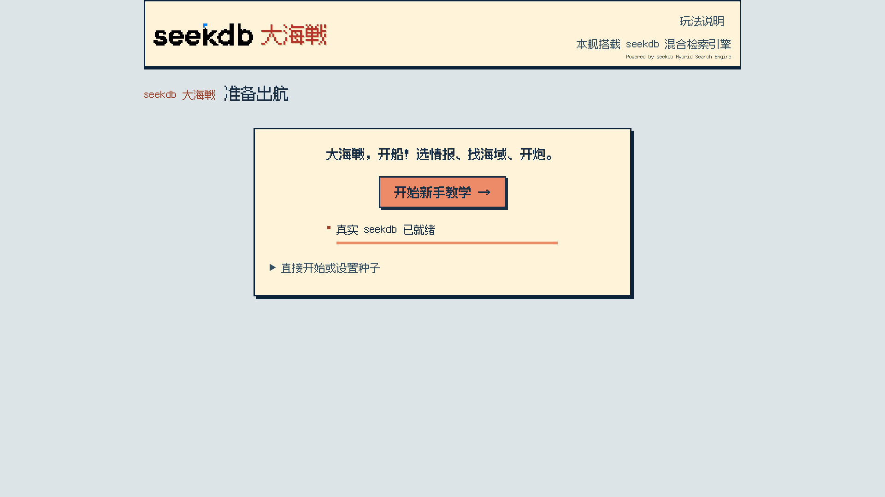

下载 macOS 或 Windows 的完整 ZIP，先解压，再运行其中的启动器。启动器会在固定网址 `http://127.0.0.1:8876/` 提供游戏页面，并用浏览器打开它。保持启动器运行；浏览器首次装入和编译真实 seekdb 引擎时，请稍候。

再次打开同一版本会复用已经运行的服务。若端口被其他程序或旧启动器占用，会提示关闭旧启动器或释放端口后重试，不会自动改用其他端口，也不会停止其他进程。请使用同一浏览器、同一用户配置和原地址找回存档；`localhost`、`127.0.0.1`、不同端口和不同浏览器之间不共享这份本地存档。

离线 HTML 已包含游戏脚本、字体、品牌图片和两种官方 WASM 引擎。正常游戏运行使用本机资源；卡片上的官方介绍链接需要你主动点击才会打开网页。

请运行包内的“点此开玩”启动文件。直接双击 HTML 不能进入游戏；启动器会提供浏览器运行真实引擎所需的本机环境。自行部署和源码启动方法见[项目首页](../README.md#从源码启动与开发)。

### 教学可以跳过，部署不能跳过

教学有三页，可以逐页阅读，也可以在任意一页点击“跳过教学，去布阵”。首页“直接开始或设置种子”中的“直接开始”也会进入部署页。

这些操作只省略教学。你仍须确认我方舰队，才能领取本关资料、执行定位查询和进入战斗。

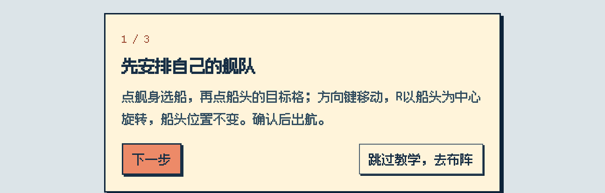

### 种子用于复盘，不是续关密码

首页可以使用随机种子，也可以输入自己的海图种子。敌方每关从 128 个固定合法阵形中选取一个；种子决定本次选择。相同种子便于复盘，不同种子可能选到不同阵形，也可能碰巧选到相同阵形。

本作没有密码续关。种子用于复现布局；继续原局依靠 OPFS 存档，不需要重新输入种子。

### OPFS 保存完整战役，刷新继续原局

本版由真实 seekdb 将完整战役写入浏览器 OPFS：包括我方舰队、敌方阵形、伤害、弹药、当前关卡、勋章、试错冷却、SQL 线索和战报。在同一浏览器、同一地址刷新或重新打开，会读取最近成功保存的状态，继续原局。

请以页面的保存成功提示为准。还在保存或出现写入错误时，不代表最新动作已经落盘；不要把刷新当作撤销操作。进入下一关、Fork 重开本关、胜利或失败都不会自动删除当前战役数据库。

OPFS 需要当前浏览器支持文件存储和 Web Locks。同一网址一次只能有一个标签页或窗口打开这份持久数据库；若提示占用，请关闭原标签页或窗口，稍候再刷新。不要通过新端口绕过占用，否则看到的是另一个存档空间。

存档仅在当前浏览器本地，不是跨浏览器或跨设备云同步。**清理网站数据会删除存档**，隐私窗口关闭后也可能删除数据。浏览器可能拒绝持久存储保护或遇到配额错误；异常退出、断电时也不保证最后记录完整。新版源码已在独立桌面 Chromium、Playwright Firefox 和 Playwright WebKit 中完成真实 OPFS 检查；当前最终离线单页已在 Chromium 验证刷新及关闭浏览器后恢复，最终包也已在 Playwright Firefox、持久配置 WebKit 中各通过 4/4 项复测。Playwright WebKit 不等于原生 Safari，原生 Safari 新版 OPFS 仍待补测，不能沿用旧内存版的通过结论。详见[本地存档说明](persistence.md)与[验证记录](stability.md)。

### “重开新游戏”会删除旧局

每次新战役实际执行 `CREATE DATABASE`，数据库名为 `seekdb_naval_时间戳`。顶栏“重开新游戏”是删除旧局并建立新战役的入口。打开手册后，弹窗标题栏也有这个按钮；标题栏保持在顶部，读到底仍能点到：

1. 先确认愿意放弃当前战役；按钮没有第二次确认弹窗。
2. 点击“重开新游戏”。若有查询、保存或行动正在执行，先等待旧操作完成或回滚，再实际执行 `DROP DATABASE` 删除旧局，并创建新的独立数据库。
3. 等待创建和保存成功，再从第一关部署舰队；旧局的进度、勋章、笔记和弹药不会迁移。

这个入口在教学、部署、情报、海图、交战和结果页都可使用；正在操作时也可以提出重开请求，等待页面完成重开即可。旧档写入失败时，仍可用它放弃旧局。

单纯刷新不发起删库；但如果已经点击重开、请求已保存，刷新后会继续未完成的重开，而不是撤销删库。删除或创建失败时会保留恢复信息，不能继续操作尚未完成切换的旧局。新局首档保存前失败，会清理并重建同名目标库；首档已经保存、只是目录收尾失败时，会恢复已保存的新局，保留种子，不再重新随机。“试错机会”只重开当前关，不等于“重开新游戏”。

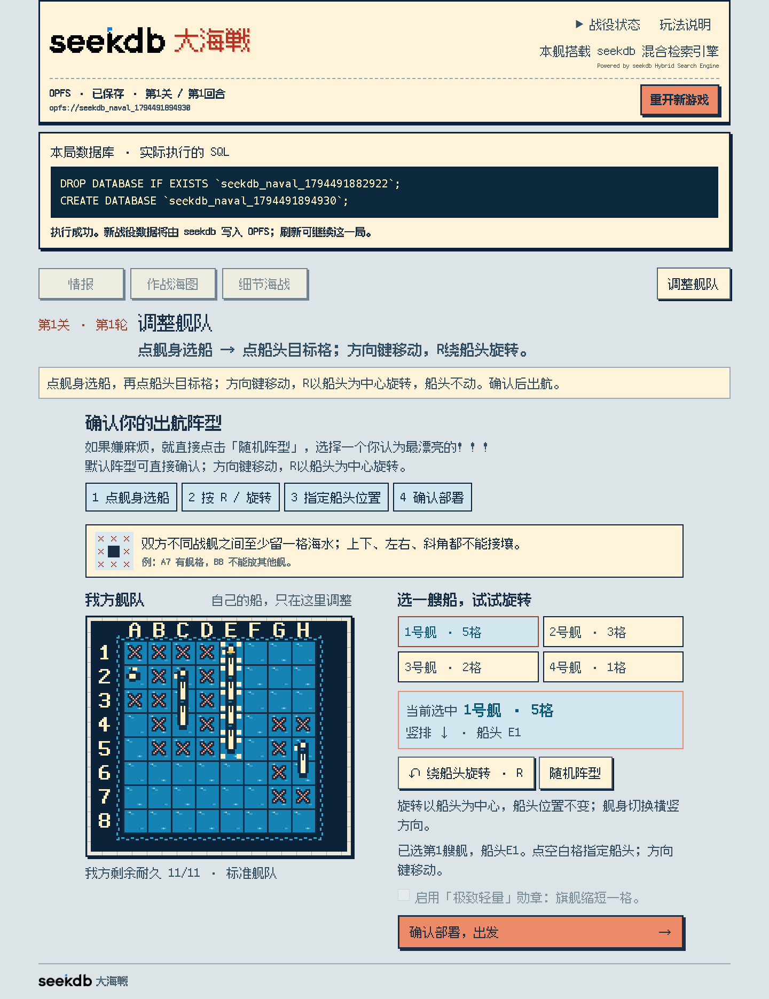

## 2. 出航前：部署我方舰队

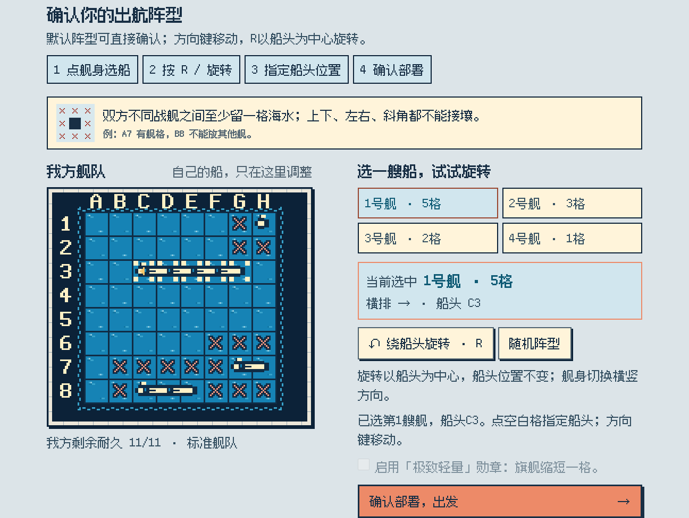

### 看懂船头和战舰长度

我方海图显示自己的全部战舰。黄色小三角标出船头，它是放置和旋转的基准。战舰长度为一艘船占据的格数；每个舰格只有一点耐久。

第一关我方战舰长度为 **5、3、2、1**，合计 11 格。你有一艘单格潜艇，敌方第一关的战舰长度则为 **5、3、2、2**。第二关敌方仍没有单格舰。双方舰队编制并不完全相同。

### 选择、移动和旋转

| 操作 | 结果 |
| --- | --- |
| 点击一艘船的任意舰格，或点击舰名 | 选中这艘船 |
| 选中后点击另一空白格 | 把船头移到该格，整艘船随之移动 |
| 按方向键 | 让当前船头移动一格 |
| 按 `R`，或点“绕船头旋转” | 船头不动，在横排与竖排之间切换 |
| 点击“随机阵型” | 重新生成我方合法阵型 |
| 点击“确认部署，出发” | 建立本关开局状态并领取情报 |

横排舰体从船头向右延伸，竖排舰体从船头向下延伸。点击的位置是**船头**，不是舰体中心。靠近右边或下边时，要给其余舰格留出空间。单格潜艇旋转后外观不会变化。

部署页使用方向键会移动选中战舰，并阻止页面跟着滚动；在种子等输入框中编辑文字时，方向键仍用于文字操作。

### 不同战舰不能接壤

双方都遵守相同间距规则：不同战舰之间至少留一格海水，横向、竖向和斜角都不能接壤。

```text
× × ×
× ■ ×
× × ×
```

`■` 是某艘船的一个舰格，周围八格中的 `×` 都不能放另一艘船。同一艘船自己的连续舰格可以相邻；舰体必须横直或竖直，不能斜放、弯折或重叠。

非法移动或旋转会被拒绝，原阵型保留。看提示中的越界或接壤原因，换一个更空旷的船头位置即可。

### 极致轻量

第一关领奖后，从第二关起可以启用“极致轻量”。它把一艘最长战舰缩短一格，舰体总耐久也随之减少一格。部署页可用复选框切换；它不会给缩短后的格子额外装甲。

例如第二关默认启用轻量后，我方战舰长度为 4、3、2、1，合计 10 格。轻量勋章同时解锁的三联炮是另一项能力，见武器章节。

## 3. Part I：先定位海域

### 按任务目标逐组选择

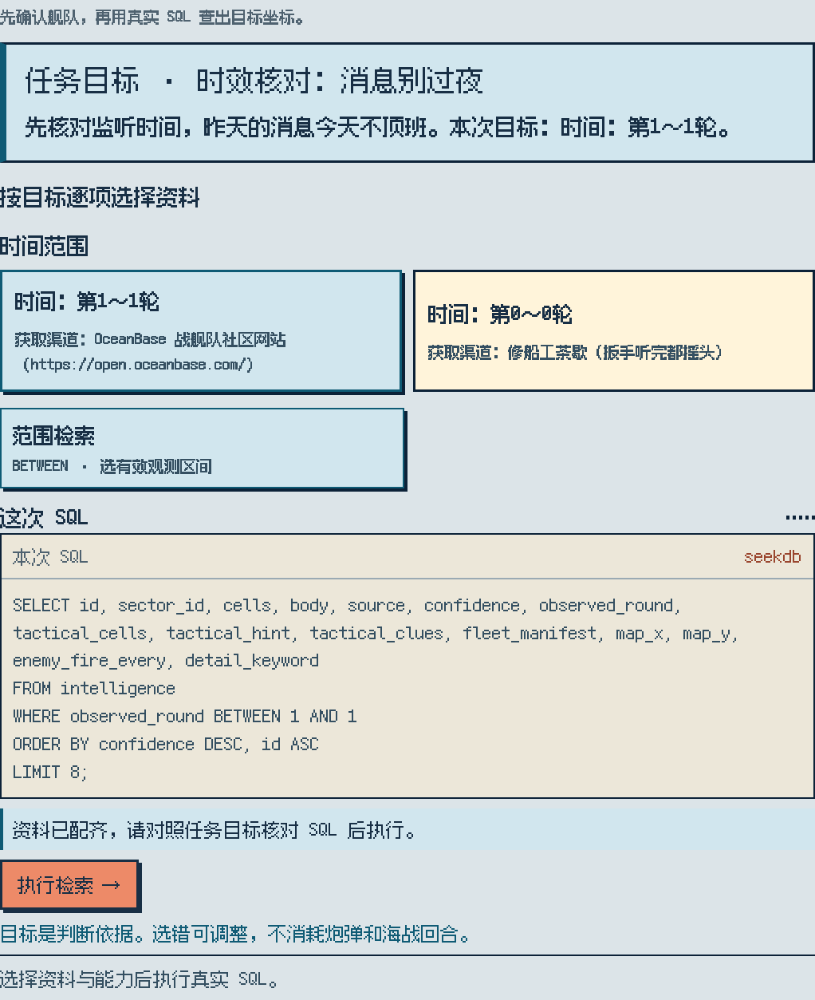

定位页上方给出本关任务目标，下方按检索方式分组。**每组有两份资料，一份符合目标，一份存在具体差异。** 每组只能选一份；再次点击已选资料可以取消，点击另一份可以替换。

目标和资料使用相同字段，你可以直接核对，不需要猜隐藏答案。应先看时间、口令、回波和任务信源，再看“获取渠道”的趣味文案。获取渠道是叙事说明；数据库中的“岸基观察站”“舰载雷达站”等信源字段另有含义。

| 定位检索 | 从哪关使用 | 主要核对什么 | SQL 中的对应能力 |
| --- | --- | --- | --- |
| 范围检索 | 第一关 | 当前有效监听时间，排除旧档案 | `BETWEEN` |
| 全文检索 | 第二关 | 本次编队的完整英文口令 | `MATCH … AGAINST` |
| 向量检索 | 第三关 | 军用推进器回波，排除民船样本 | `l2_distance` |
| 条件筛选 | 第四关 | 本次行动、可靠来源和可信度 | `WHERE` 等条件 |
| 双源确认 | 第六关强化 | 同海区至少两个独立可靠来源 | `COUNT(DISTINCT source)` |

点击资料会自动装入对应能力，实时更新 SQL。你不需要手写代码。缺少本关任何一组资料时，界面会列出缺项，执行按钮暂不可用。

当前可靠条件卡只采纳岸基观察站或舰载雷达站，要求本次行动、可信度至少85；第六关再增加同海区至少两个独立来源的要求。

任务中的口令、监听词和渠道会随关卡、战役种子变化。请看本次屏幕目标，不必背示例中的某个英文词。

### 执行与免费调整

配齐资料后，点击“执行检索”。游戏把屏幕上的 SQL 交给真实 seekdb 执行，并根据实际返回记录判断是否已指向本次目标海域。

选错后会解释时间、口令、回波或任务信源的具体差异。你可以改选后重新执行，**不消耗炮弹，不推进海战轮次，也没有“两次之后自动保底”的规则**。

定位成功给出的是一整片交战海域，尺寸为本关的 8×8、10×10 或 12×12。它不会标出全部舰身。具体舰格仍要靠后续线索、雷达和炮击判断。

第六关的“双源”数的是数据库中的独立观测站。不同获取渠道转述同一个站点，并不会自动算成多个独立来源。

## 4. 追加侦察：回波与监听一起查

定位完成后进入“情报解读”。这里展示刚执行的 SQL、可靠站点报告和第一条开局统计。此时还需要完成追加侦察，才能出航。

### 两张有效资料，各点一次

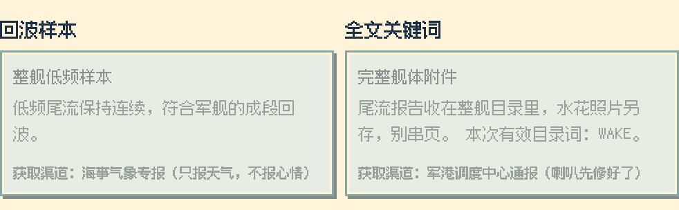

追加侦察提供一张有效回波卡和一张有效监听卡。分别点击它们，把回波向量和监听词加入 SQL，再点击“执行混合检索”。这一步不再要求从干扰卡中二选一。

第一次定位检索的能力按关卡逐步增加；**第二次追加侦察从第一关起就使用回波加监听词**，由系统为你装配。两者是不同步骤。

界面会执行并比较三种真实查询：

| 查询 | 能做什么 | 还可能混入什么 |
| --- | --- | --- |
| 仅回波 | 找到相近的人工回波特征 | 其他监听目录里的同类信号 |
| 仅监听 | 找到含监听关键词的记录 | 同词的民船或天气记录 |
| 混合条件 | 同时匹配回波、监听词及当前任务海区 | 返回符合这些条件的战术观测 |

比较栏中的候选数量来自实际 SQL。混合查询返回的战术线索才会进入手册并启用对应支持能力。

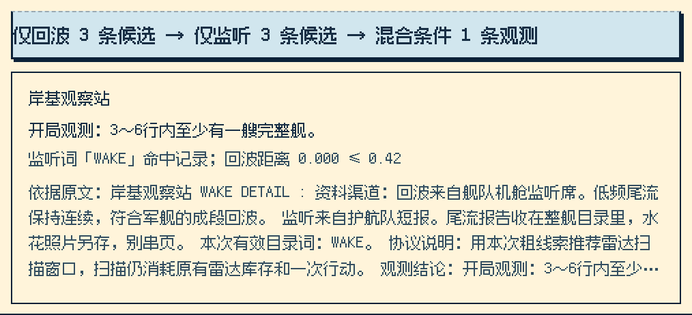

结果卡还会显示命中的监听词、回波距离、来源和依据原文。回波距离越小表示特征越接近；**这不是敌舰离你多少格的距离**。本作用八维人工战术特征表达回波，不需要玩家理解或计算向量。

### 开局统计怎么读

“A～D列有7个舰格，E～H列有5个”统计的是舰格数，不是船只数。若两侧相同，文字会明确写成“各有6个舰格”。它不能告诉你每一格是否有船。

所有这些观测都指向**开局**。击伤、击沉后，开局统计不会跟着减少；它与当前剩余敌舰数量表达的是不同信息。

### 六关各有不同的额外观察

| 关卡 | 追加侦察带回的观察 | 可据此做的判断 |
| --- | --- | --- |
| 第一关 | 一段宽带中至少有一艘完整舰 | 从宽带安排搜索，带外仍可有其他舰 |
| 第二关 | 一块确认无舰的 2×2 海域 | 排除这四格，节省炮击 |
| 第三关 | 至少一艘当前最长舰的长度与横竖方向 | 找到相关命中后，考虑长舰朝向 |
| 第四关 | 至少一艘长舰跨过指定行列分界 | 在分界两侧保留同一艘船延伸的可能 |
| 第五关 | 单格潜艇所在半盘，以及一块空2×2海域 | 结合候选半盘和空海安排侦察 |
| 第六关 | 单格潜艇所在五行或五列的宽带，以及一块空3×3海域 | 用空海减少候选，再规划搜潜与多点覆盖 |

“至少一艘”只保证存在性。两条分别写“至少一艘”的线索，可能指向不同战舰，不应直接把两个区域的交集当作某艘船的精确位置。线索不会随重复查询或试错重开继续缩小。

### 自动定位，再确认出航

取得混合线索后，点击“带线索出航”。游戏依据真实 SQL 返回的坐标自动标记大海图，你只需检查位置并点击“就是这里，出航！”。当前版本不要求手工在大海图上钉点，也不能跳过检索盲选交战区。

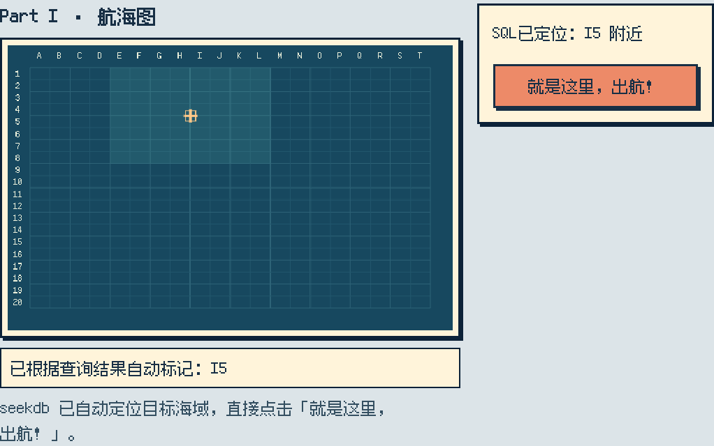

## 5. Part II：看图、选格、发射

### 两张海图

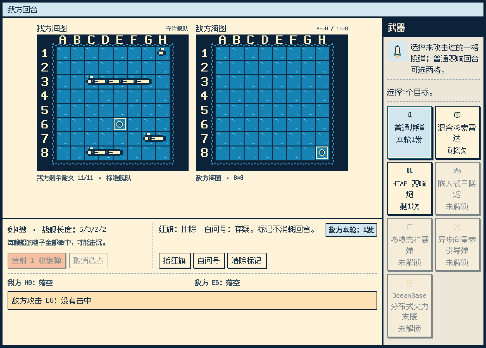

左侧是我方海图，显示自己的战舰及受击情况；右侧是敌方海图，开局隐藏敌舰。右侧武器菜单用于选择普通炮、雷达和已解锁装备。

横坐标使用字母，纵坐标使用数字：8×8盘为 A～H／1～8，10×10盘为 A～J／1～10，12×12盘为 A～L／1～12。例如 `C4` 指 C 列、第 4 行。

战术手册显示已通过 SQL 获得的线索，敌舰概览显示公开编制和已确认击沉情况。敌舰不会在战斗中移动，试错重开也保持本关原有阵形。

交战时默认“适应屏幕”，将顶部 Logo、完整战术手册和核心海战区整体等比例放入当前桌面窗口；双棋盘、武器、发射、标记和反馈一起保留。窗口较小时文字也会同比缩小，可切换“原始大小”恢复显示。完整 SQL、雷达逐格表和长战报在核心区下方，主动查看时才需要向下滚动。

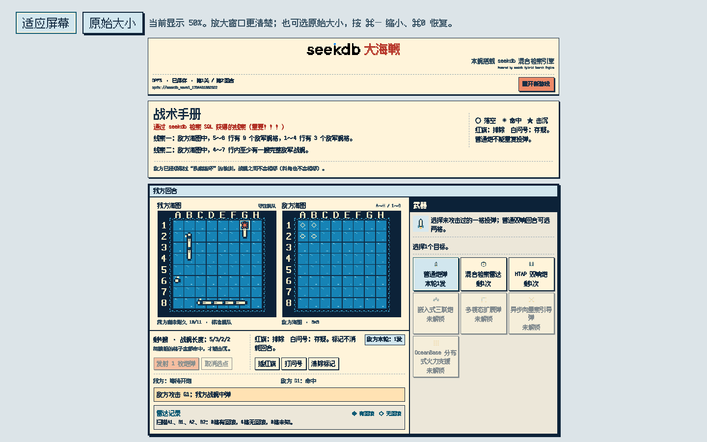

### 一个行动怎样结束

1. 在菜单选择武器。
2. 在敌方海图选足本次所需坐标，或选择完整模板的左上角。
3. 检查覆盖预览，点击发射或扫描。
4. 阅读我方结果和敌方反击，进入下一轮。

命中不会自动赠送额外行动。双发、三联和多点弹是在同一次行动中结算多个落点；行动完成后，敌方按本轮火力反击。雷达虽然不造成伤害，也占一次行动。

同一艘船的所有舰格被命中后才算击沉。击沉全部敌舰即胜利；若本次炮击已经击沉最后一艘敌舰，就直接结束本关。

### 普通投弹与多点覆盖的区别

普通炮弹不能再次选择本关已经投过炸弹的坐标；MySQL 普通双响回合的两个坐标也必须是新坐标。

双发、三联及固定模板的多点武器可以覆盖旧投弹格，但旧格不再受到第二次伤害，只结算新格。弹药和行动仍照常消耗，因此应尽量把覆盖留给尚未攻击的格子。同一次手选齐射中，坐标不能重复；再次点击已选坐标会取消该点。

### 雷达有回波，不等于已经命中

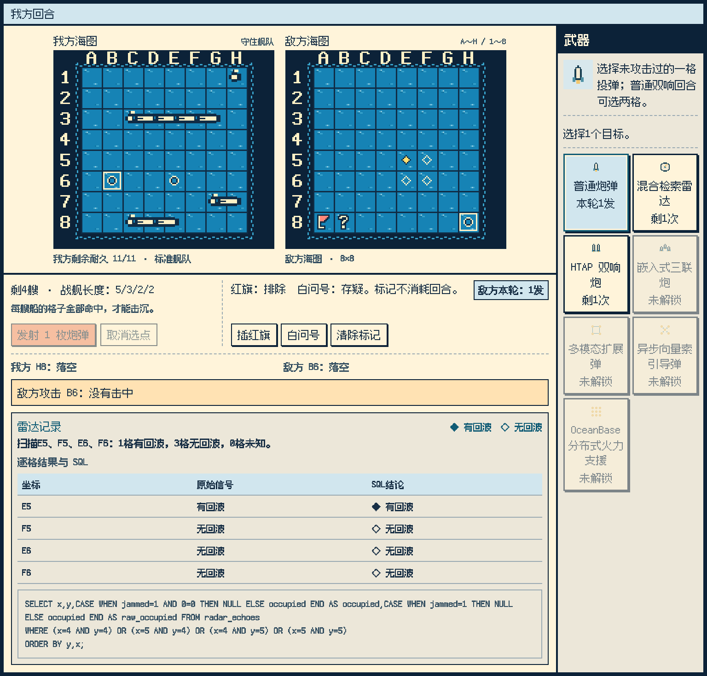

图中落点与回波属于示例种子，不是所有战役的固定答案。

雷达查询完整2×2区域，结果包括有回波、无回波，以及受扰时的未知。

- **有回波**：该格存在开局舰体占位；本次扫描本身不造成伤害。
- **无回波**：该格没有舰体占位，扫描没有把它变成“已投弹”。
- **未知**：当前信号不足以判断，不能按空海排除。

正、负雷达结论都会留在海图；你仍可以向扫描过但没有投过炸弹的格子发射。下方可阅读逐格扫描结果和实际 SQL。雷达不是剩余耐久表，扫描旧格也不会清除或重置既有命中记录。

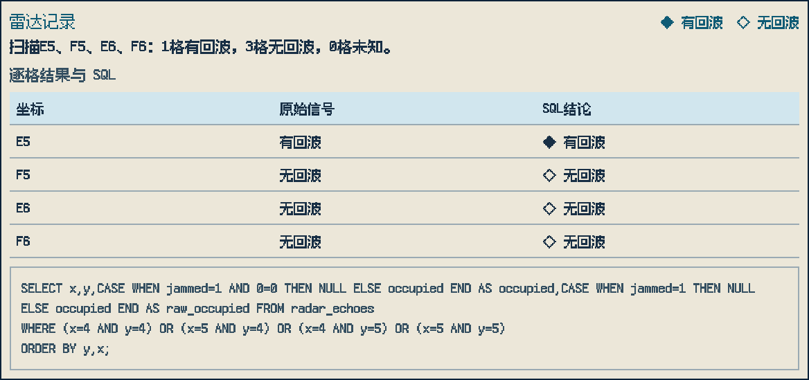

第五关存在原始雷达干扰。可靠混合观测提供滤波支持后，以查询的“SQL结论”为准；原始信号显示未知，并不意味着那格无舰。

### 红旗、白问号和 SQL 标空海

先选一个未投弹格，再点击“插红旗”“打问号”或“清除标记”。也可在敌方海图上右键循环：红旗 → 白问号 → 清除。

红旗表示你决定排除，白问号表示存疑。手工标记不会替你判定真值，也不造成伤害、不消耗回合。它们与命中、落空记录相互区别。

取得可靠空海线索后，会出现“根据 SQL 检索线索标记空海”。它只把实际查询确认的空格加上红旗，不会读取隐藏舰位，也不会把活动带外的所有格子都判为空海。

### 展开战报与笔记

最新战报只显示短摘要。点击“展开战报与笔记”可阅读投弹坐标、完整作战记录和检索笔记，页面会把展开内容带到可见位置；再次点击“收起战报与笔记”可折叠。

部署页和作战结果页会恢复折叠状态。试错重开前的公开笔记会保留，并标识为前分支记录；当前海图上的攻击和雷达状态会重新开始。

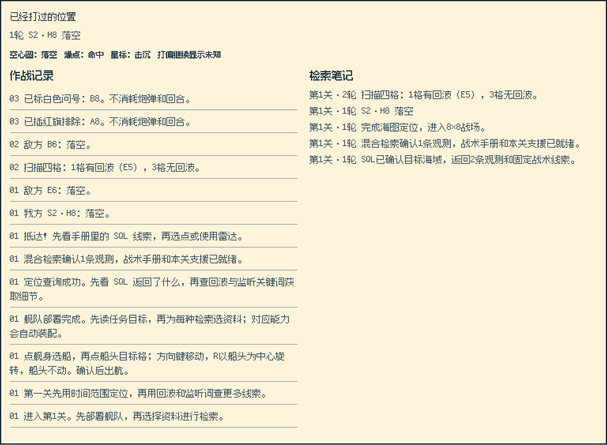

## 6. 武器图鉴

### 七种武器与操作方式

| 武器 | 选点方式与效果 | 最早可用 |
| --- | --- | --- |
| 普通炮弹 | 手选一个新坐标；MySQL普通双响轮手选两个新坐标 | 第一关 |
| 混合检索雷达 | 选完整2×2模板的左上角，扫描四格，不造成伤害 | 第一关 |
| HTAP 双响炮 | 手选两个不同坐标，一次行动投弹 | 第一关 |
| 嵌入式三联炮 | 手选三个不同坐标，一次行动投弹 | 第二关 |
| 多模态扩展弹 | 完整4×4范围的四角，共4点 | 第五关 |
| 异步向量索引导弹 | 完整3×3范围的四角加中心，共5点X形 | 第六关 |
| OceanBase 分布式火力支援 | 完整5×5范围隔格布置，共9点 | 第六关 |

### 固定模板的形状

下图中 `●` 为攻击点，`·` 为模板内不投弹的格。选择坐标时，点的是整个模板的**左上角**。

多模态扩展弹 · 4×4四角：

```text
● · · ●
· · · ·
· · · ·
● · · ●
```

异步向量索引导弹 · 3×3五点X：

```text
● · ●
· ● ·
● · ●
```

OceanBase 分布式火力支援 · 5×5隔格九点：

```text
● · ● · ●
· · · · ·
● · ● · ●
· · · · ·
● · ● · ●
```

模板必须完整放在棋盘内，不会在边缘裁掉一部分。雷达也遵守完整2×2的要求；若提示范围放不下，把左上角向海图内侧移动。上述固定多点武器不需要选择横向或竖向。

### 每关的雷达、双响炮和三联炮

以下库存在进入本关时重新补给，不会把上一关剩余次数累积过来。

| 关卡 | 雷达 | HTAP 双响炮 | 嵌入式三联炮 |
| --- | ---: | ---: | ---: |
| 第一关 | 2次 | 1次 | 未解锁 |
| 第二关 | 2次 | 1次 | 1次 |
| 第三关 | 3次 | 2次 | 1次 |
| 第四关 | 3次 | 2次 | 1次 |
| 第五关 | 5次 | 3次 | 2次 |
| 第六关 | 5次 | 3次 | 2次 |

第五关有一份扩展弹包，可发射一次多模态扩展弹。第六关同一份弹包可以选择多模态扩展弹或 OceanBase 分布式火力支援，**二者合计只能用一次**。第六关的异步向量索引导弹另有一枚独立弹药。

### 两种“双响”怎样区分

**HTAP 双响炮**是有限库存装备：选择它，消耗一次双响炮库存，手选两个坐标。

**MySQL兼容双响炮**来自第三关奖励，从第四关起生效：在第4、8、12……轮使用普通炮时，可以同时选择两个新坐标，不消耗 HTAP 双响炮库存。

周期普通双响不与其他武器叠加。在双响轮选择雷达、三联炮或固定模板弹，仍只执行该武器的一次行动，不会再多加两发普通炮。

武器卡把“游戏效果”和“seekdb特性”分开展示，可点官方链接了解名称对应的数据库能力。游戏中的 OceanBase 火力支援仍由本地 seekdb 执行范围 SQL 选格；分布式扩展能力介绍指向 OceanBase。

## 7. 六关航路与敌方火力

| 关卡 | 战术海图 | 敌方战舰长度 | 定位检索要求 | 敌方基准火力 | 轮数上限 |
| --- | --- | --- | --- | --- | ---: |
| 1 初航·静海监听 | 8×8 | 5、3、2、2 | 范围 | 每轮1发 | 48 |
| 2 迷雾·信源甄别 | 8×8 | 5、4、2、2 | 范围＋全文 | 每轮1发 | 48 |
| 3 分支·变化的口令 | 10×10 | 5、4、4、3、2 | 范围＋全文＋向量 | 每4轮2发，其余1发 | 70 |
| 4 混合·同名异舰 | 10×10 | 5、5、4、4、2 | 四种检索 | 每3轮2发，其余1发 | 70 |
| 5 扩展·旧日回声 | 12×12 | 6、5、5、4、3、2、1 | 四种检索，强化干扰 | 每3轮2发，其余1发 | 96 |
| 6 终战·双源确认 | 12×12 | 6、6、5、5、4、3、1 | 四种检索＋双源确认 | 每2轮2发，其余1发 | 100 |

第一关双方普通行动都只有一发，敌方没有高级武器。敌方周期双炮会提前一轮预告；看本轮和下一轮火力提示，再决定是否使用侦察或多点武器。

表中是基准火力，可靠混合情报还提供本关反制：第三关击沉承担中继的最长舰后，可切断后续双炮；第四关在敌方双炮轮使用雷达扫频，可把本轮反击压到一发。这些支持不额外赠送雷达库存。

敌方只根据自己的公开炮击结果搜寻和追击，选点时不读取我方隐藏舰位。前两关主要随机搜索，第三关命中后尝试邻格，后几关会沿已知命中方向追击。

第五、六关重新出现敌方单格潜艇。单格舰不会留下多格追击线索，建议预留雷达，并认真使用已经查得的潜艇宽带和空海信息。

须在轮数上限内击沉全部敌舰。上限轮完成敌方反击后仍未获胜，也会判定本关失败；单纯等待或反复扫描不能无限拖延。

## 8. 胜利、领奖与试错机会

### 奖励要领取，下一关才生效

胜利后先阅读勋章、技能和武器卡，点击“确认领取勋章与装备”，再进入下一海域。奖励节奏如下：

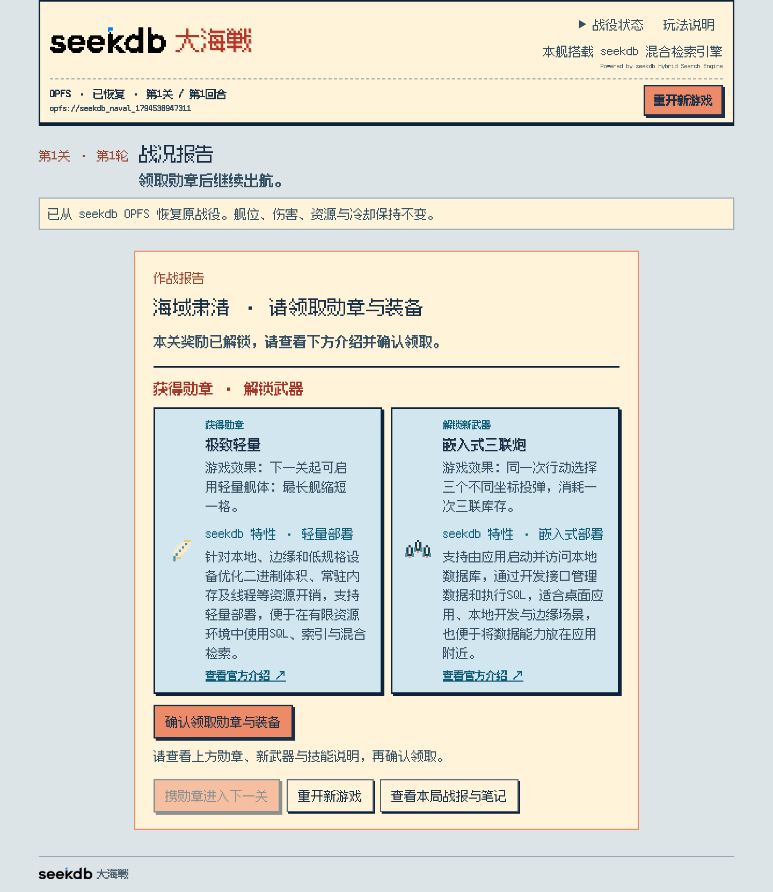

图示展示第一关的领奖界面。该页用示例状态呈现，不代表连续通关实录。

| 打通关卡 | 领取内容 | 从哪关生效 |
| --- | --- | --- |
| 第一关 | 极致轻量勋章、嵌入式三联炮 | 第二关 |
| 第二关 | Fork / Merge勋章、试错机会 | 第三关 |
| 第三关 | MySQL兼容勋章、周期普通双响 | 第四关 |
| 第四关 | 分布式扩展勋章、多模态扩展弹 | 第五关 |
| 第五关 | 异步索引勋章、异步向量索引导弹；究极分布式扩展勋章、OceanBase分布式火力支援 | 第六关 |
| 第六关 | 战役完成与战果总结 | 无新增技能 |

### 试错机会

**在关卡内或关卡失败后，可重开本关一次；敌位和重开前一致，随后需要两关冷却时间。**

取得 Fork / Merge 勋章后，从第三关起可以使用。确认部署并建立本关开局状态后，即使尚未受到敌方命中，也可以在我方可操作时展开战报，点击“试错机会”。执行 SQL 或播放行动期间，按钮暂时禁用，不能重复触发。

失败时若机会可用，结果页会显示“尚有一次试错机会”，可直接点击“试错机会·重开本关”。若本关机会已用、技能仍在冷却或尚未解锁，则本轮战役结束。重开后再次失败，也会结束本轮。

使用后，紧接的两关处于冷却，第三关恢复。例如第三关使用后，第四、第五关不可用，第六关恢复。每关最多一次，并不表示可以连续每关都使用。

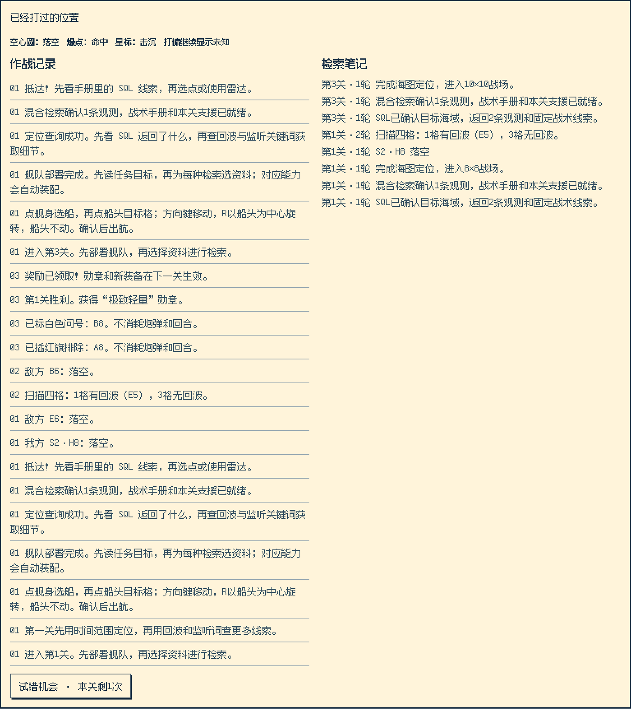

图示展示第三关的试错入口。定位和重开均实际执行，属于独立关卡示例。

### 重开保留什么、恢复什么

| 保留 | 恢复到本关开局 |
| --- | --- |
| 敌舰阵形、敌舰所在海域 | 双方舰体耐久 |
| 已获得勋章和战役身份 | 本关弹药与轮次 |
| Merge保留的公开检索、炮击笔记 | 投弹历史、敌我攻击知识和地图标记 |
| 作为记忆参考的前分支记录 | 雷达记录、已取得的额外线索和检索进度 |

重开会回到情报流程，需要重新查询、阅读结果并确认出航。旧笔记可以帮助你试另一种战术，当前海图不会把旧分支的炮击当作这次已经投弹。

重开使用真实 seekdb 的分支与笔记合并。若数据库动作报错，本次次数和冷却不会在动作未完成时被消耗，恢复可操作后可以重试。

### Game Over

我方所有舰格被击中，或海战轮数耗尽，都会触发失败。若没有可用试错机会，本轮战役结束，结果仍会保存在当前数据库中。想重新挑战时，点击始终可见的“重开新游戏”：实际删除旧局、创建新数据库，从第一关开始并清空本轮勋章。它不会让你带着本轮装备继续当前关；失败本身不自动删库。

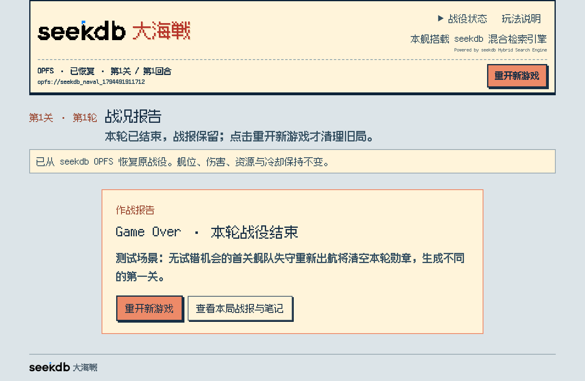

## 9. 按键与图例速查

| 场景 | 按键或操作 | 功能 |
| --- | --- | --- |
| 通用 | `Tab` | 在可操作控件间移动焦点 |
| 通用 | 按钮上按 `Enter` | 激活按钮 |
| 部署 | 点击船身或舰名 | 选船 |
| 部署 | 点击空白格 | 将船头放到该格 |
| 部署 | 方向键 | 移动当前战舰，页面不随键滚动 |
| 部署 | `R` | 绕船头横竖旋转 |
| 敌方海图获得焦点后 | 方向键 | 移动键盘选点位置 |
| 敌方海图获得焦点后 | `Enter`／空格 | 选中或取消该格，之后仍须点发射 |
| 海战 | 右键未投弹格 | 红旗、白问号、清除循环 |
| 手册对话框 | `Esc` | 关闭手册 |

| 海图或回执 | 含义 |
| --- | --- |
| 空心圆 `○` | 炮弹落空，这格没有击中舰体 |
| 爆点 `✹` | 舰格命中 |
| 星标 `★` | 对应战舰已击沉 |
| 雷达 `◆` | 有舰体回波，尚未造成伤害 |
| 雷达 `◇` | 无舰体回波，扫描不等于投弹 |
| 雷达 `？` | 受扰或未知，不能当作空海 |
| 红旗 | 玩家排除标记，或根据可靠空海SQL批量标记 |
| 白问号 | 玩家暂时存疑的标记 |

若回执出现“打偏”，请按未知信息处理，不要把它当成“落空”来排除舰位。正常出航入口已经要求正确定位海域。

## 10. 常见问题

**为什么舰船总放不进去？**

检查点下去的是船头位置，并给右侧或下侧舰体留出长度。另一艘船的斜角也不能贴住；非法移动会保留旧阵型。默认合法阵型可以直接确认。

**为什么点了开始，还要确认部署？**

教学或直接开始只决定是否读教学。确认部署还负责建立本关开局状态，后续查询和试错都要以它为基准。

**为什么执行按钮还是灰色？**

定位页要为本关每组选择一份资料；追加侦察要把回波和监听两张卡都点上。还在执行数据库操作、播放行动，或混合侦察已完成时，相应按钮也会暂时禁用。

**情报不是说右边更多，怎么右边打空了？**

开局统计比较整片区域的舰格数，不保证其中任意一个格子有船。宽带、舰向和跨线也都是粗观察，应结合炮击结果继续推理。

**击沉后，开局统计为什么没变？**

它记录开局编制，不是实时声呐计数。当前剩余舰队看敌舰概览和击沉回执；不要从旧统计中重复扣数后误读其原意。

**雷达扫到敌舰，为什么它没有受伤？**

雷达只读取占位，需要再用炮弹攻击。扫过的格子仍可正常投弹；只有已经投过普通炮弹的格子不能再被普通炮重打。

**范围里有已经打过的格，能不能用多点武器？**

可以，旧格不重复伤害；该武器照常消耗弹药和行动。真正不能重复的是普通投弹坐标。固定模板另须完整放在海图内。

**为什么看见两个“双响”，却没得到四发？**

有限库存 HTAP 双响炮和每四轮触发的 MySQL 普通双响是两种选择，不能叠加。看当前菜单选中的武器及“本轮几发”提示。

**同一舰队能不能先移动躲炮？**

舰队部署确认后，海战中的船不会移动。敌舰阵形也固定。试错重开保持敌位，让你用公开笔记重新安排搜索和弹药。

**刷新网页会回到试错前吗？**

不会。刷新会读取最近成功保存的状态；已经使用试错机会并保存后，已消耗次数和冷却也会保留。尚未结算完的炮击会按保存的待处理记录恢复，不会因为再次刷新就额外投一轮。要按规则回到本关开局，请使用“试错机会”；要删除旧局并从第一关开始，请点击“重开新游戏”。

**为什么重新打开后看不到原存档？**

先核对是否仍使用原浏览器、原用户配置和 `http://127.0.0.1:8876/`。换浏览器、换端口或把主机名改成 `localhost` 都是另一个存档空间；源码服务默认的 8768 也与试玩包不同。若原网站数据已被清理，或隐私模式结束时被删除，OPFS 无法保证找回。

**提示数据库正在被其他标签页占用怎么办？**

关闭打开同一游戏地址的其他标签页或窗口，稍候后在当前页刷新。不要清理网站数据来解锁；那会删除存档。

**为什么一定要用启动器，SQL到底在哪里执行？**

启动器提供运行多线程 WASM 所需的本地响应头。SQL仍在浏览器内的真实 seekdb 引擎中执行，定位、混合侦察、雷达和固定多点选格均使用本地数据查询。

## 11. 第一关的稳妥练习

先保持默认合法阵型，走完一次定位和混合侦察。读清统计比较的行列、完整舰宽带的范围，把它们当作搜索优先级。

在重点区域使用一次雷达，观察有回波与无回波怎样留在图上。若扫出有回波格，再选择普通炮攻击；命中后考虑横竖延伸，落空则换一个尚未攻击的候选。需要一次试探两个远近位置时，再使用有限库存的 HTAP 双响炮。

敌方舰艇之间不会接壤。击沉后可以结合间距规则自行插旗，但标记与真实投弹历史要分开。若一时找不到目标，展开完整战报与笔记，先排除已验证的判断，再安排下一次雷达。

先学会读准一条线索，再把下一条加进来。海域会变大，检索和弹药的选择也会逐步增加。
